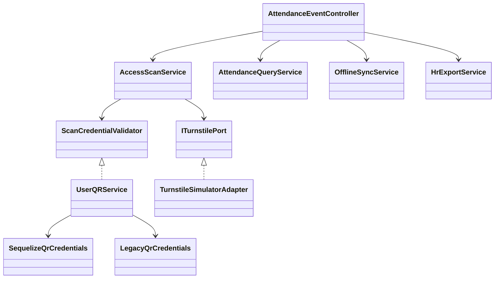

# Backend SOLID Evidence

CO3017 Assignment 2 · NestJS, TypeScript, Sequelize, and PostgreSQL

## Baseline and scope

The clean checkout started at backend `main` commit `7fe7fec4927b423a51f264dff395bf80f57feca7`. The frontend contract reference was commit `0f10c8260be898efa4cb924cf3a975c9050fb95e`. The refactor covers backend access scans, attendance queries, human resources (HR) export, signed offline synchronization, QR credentials, and authentication. Routes, successful response schemas, enum values, and migrations remain compatible. Security changes intentionally introduce authentication and role or ownership checks on selected endpoints.

At baseline, the build passed and all 49 unit tests passed. The repository tracks `yarn.lock`, so `npm ci` reported a missing npm lockfile. The verification environment installed dependencies with `npm install --no-package-lock --no-audit --no-fund`. The baseline end-to-end (E2E) smoke test passed against migrated PostgreSQL when Jest used `NODE_OPTIONS=--experimental-vm-modules`. It left an open application handle, now closed by the test teardown. With database mode disabled, the baseline application could not resolve the attendance Sequelize providers. The full application and its E2E suite use `ENABLE_DB=true`.

## SOLID assessment

| Principle | Original limitation | Source evidence and change | Test evidence | Status |
|---|---|---|---|---|
| Single Responsibility (SRP) | One attendance service handled scans, queries, exports and signed reconciliation. QR demo state shared a service with database credential lifecycle. | `src/modules/attendance-event/access-scan.service.ts:40` (`submitAccessScan`), `attendance-query.service.ts:15` (`getRecentEvents`), `offline-sync.service.ts:50` (`syncOfflineScans`), and `hr-export.service.ts:17` (`exportHRBatch`). The controller routes requests directly to the corresponding service. `LegacyQrCredentials` and `SequelizeQrCredentials` own different credential lifecycles. Commits `f21be83`, `e3cc424`, `b71e02f`. | `attendance-event.service.spec.ts` exercises query and scan results. `attendance-event.offline.spec.ts` instantiates signed reconciliation without QR or turnstile providers. `test/attendance-postgres.e2e-spec.ts` verifies both routes with real storage. | Verified for extracted workflows. |
| Open/Closed (OCP) | Scan orchestration already accepted a turnstile port, but depended on the whole concrete QR service. | `src/modules/attendance-event/access-scan.service.ts:29` injects `SCAN_CREDENTIAL_VALIDATOR` beside `TURNSTILE_PORT`. Module composition binds the default validator in `src/modules/user-qr/user-qr.module.ts:34` and the turnstile in `src/adapters/turnstile/turnstile.module.ts:9`. Commit `b71e02f`. | `uses substitute credential and turnstile ports with request correlation` replaces both providers without changing the scan service. | Verified at both scan boundaries. |
| Liskov Substitution (LSP) | The turnstile interface described shape. Existing tests exercised one adapter. Legacy and database credentials have different security guarantees. | `ITurnstilePort.unlockTurnstile` in `src/adapters/turnstile/turnstile.port.ts` keeps the existing outcome contract. `src/modules/user-qr/user-qr.service.ts:53` routes legacy payloads only in compatibility mode. The database adapter is the live authority in database mode. Commits `d025328`, `f8e13e6`. | `src/adapters/turnstile/turnstile.contract.spec.ts` runs the same success, mechanical fault and timeout cases on the simulator and deterministic adapter, checking result shape. The scan substitution test checks Request ID, Event ID, station and one attempt after timeout. PostgreSQL tests cover valid, forged, expired, revoked and consumed database credentials. | Verified for the two testable turnstile implementations. Legacy and database QR policies have separate scopes. |
| Interface Segregation (ISP) | The scan consumer could reach QR issuance and management operations. The bearer guard accessed the token model directly. | `src/modules/user-qr/scan-credential.port.ts` exposes a single validation operation. `src/modules/auth/auth-persistence.port.ts` gives the guard `AccessSessionReader.hasActiveAccess` and gives authentication separate identity and session contracts. Commits `b71e02f`, `b731875`. | The scan test supplies a validation-only object. `auth.service.spec.ts` uses identity and session fakes. HTTP tests cover the real guard with and without a live session. | Verified for scan validation and the bearer guard. |
| Dependency Inversion (DIP) | Authentication policies and its bearer guard queried static Sequelize models directly. | `src/modules/auth/auth.service.ts:113` and `:191` use injected identity and session ports. `src/modules/auth/guards/jwt-auth.guard.ts:54` uses a read-only session port. `src/modules/auth/auth.module.ts:36` binds the Sequelize adapters. `src/modules/auth/sequelize-auth-persistence.ts:64` implements conditional rotation under a transaction and user-row lock. Commit `b731875`. | `auth.service.spec.ts` verifies credential checks, hashed token storage and rejected rotation with alternate providers. PostgreSQL verifies one successful refresh under concurrent rotation and revocation on logout. | Verified for authentication and scan adapter boundaries. Scan and offline persistence still use Sequelize directly. |



## Transaction and security evidence

- `AccessScanService.submitAccessScan` claims the Request ID, consumes the QR presentation, and persists the access decision inside one PostgreSQL transaction at `access-scan.service.ts:73`. After commit, the service acquires a durable dispatch claim at line 152. A retry restores the stored result. A timeout retains `CONTROLLER_UNKNOWN`; a mechanical fault retains the independent approved access decision.
- `OfflineSyncService.syncOfflineScans` verifies an Ed25519 station signature, event signatures and policy before importing historical evidence. It uses a unique batch claim and persists acknowledgements with the event transaction. It has no dependencies on live credential validation or turnstile control.
- `UserQRService.generateDynamicQR` returns the existing response shape and propagates database issuance failures. Database mode rejects legacy payloads, including the old seeded demo credentials. `SequelizeQrCredentials.validateAndConsume` locks the presentation row, preserves the caller transaction, and denies invalid signatures, expiry, revocation, or ineligible users. The demo provider retains a process-local replay set in standalone compatibility mode.
- `src/config/signing-keys.ts:22` requires explicit distinct keys and rejects missing values and previous public defaults. Database mode requires `JWT_SECRET`, `JWT_REFRESH_SECRET`, and `QR_JWT_SECRET`. The standalone legacy QR component uses `LEGACY_QR_SECRET`. These are separate from offline station keys. Commit `d025328`.
- `GET /api/access/events` requires a session. Administrators and HR staff can query across employees. Other roles may query their own events, scoped to their user ID and employee code for online and offline records. `POST /api/access/export-hr` requires HR staff or administrator. Both QR issuance aliases require the matching employee or an administrator. Gate station administration already uses the administrator guard. Commit `0be6d84`.
- `QueryRawEventsDto` and `ExportHRBatchDto` now retain documented fields through the application's validation whitelist. In the baseline these classes had no validation metadata, so the global pipe could strip fields such as `employeeId` and `reportingPeriod`. Commit `4da0dde`.

## Reproduce the evidence

With Node.js 24 and the dependencies installed, run the build and TypeScript check, then the focused contract tests.

```bash
npm run build
npx tsc --noEmit
npm test -- --runInBand turnstile.contract attendance-event auth.service signing-keys
npm test -- --runInBand
```

For the E2E suite, start a local disposable PostgreSQL server and create an empty database ending in `_test`. The tests use migration-seeded demo identities and write events and sessions. The rollback case temporarily adds a constraint specific to its random Request ID and removes it in teardown. Use a local connection with permission to run migrations and alter the disposable schema.

```bash
export DATABASE_URL='postgres://localhost:5432/co3017_solid_test'
unset DATABASE_URL_POOLED
export ENABLE_DB=true CO3017_DISPOSABLE_DB=true
export JWT_SECRET='fixture-access-e2e'
export JWT_REFRESH_SECRET='fixture-refresh-e2e'
export QR_JWT_SECRET='fixture-presentation-e2e'
npm run migrate
NODE_OPTIONS=--experimental-vm-modules npm run test:e2e -- --runInBand
```

| Check | Observed result |
|---|---|
| Build and TypeScript check | Both passed. The offline test helper was explicitly typed to fix a baseline UUID template-literal inference error. |
| Jest unit tests | 62/62 passed across seven suites, up from 49/49. |
| HTTP E2E | 11/11 passed across two suites. |
| PostgreSQL | PostgreSQL 18.6, 13/13 migrations. Six DB-backed cases cover concurrent scan and Nest application recreation, rollback on database constraint failure, authorization, invalid QR credentials, signed batch retry, and concurrent token refresh plus logout. |
| Hardware | A substituted turnstile adapter was used. Physical gate movement and acknowledgement timing were outside the test. |

To demonstrate the architecture, show the four injected attendance services in `AttendanceEventController`, then run the focused attendance tests. Open `TurnstileModule` and `UserQRModule` to show the production bindings, then show the port substitution test and run the shared turnstile contract. To demonstrate persistence and atomicity, run the PostgreSQL suite. The first case reads the committed event from a separate database query during dispatch and retries after closing and recreating the Nest application. The second case forces a real PostgreSQL constraint failure and verifies both the request claim and presentation consumption rolled back.

## Limitations and frontend integration

- Live kiosk scans and recent station events still depend on a device authentication and factory-scoping design. The station lookup and administrative endpoints retain their existing role requirements. The signed offline route authenticates evidence using configured station keys. HR export remains simulated, and the existing date-range fields do not filter the raw-event query.
- The Flutter repository at `lib/features/gate_station/data/gate_station_repository.dart` sends `stationId`, `syncTimestamp` and `scans`. The backend requires the versioned signed batch with `schemaVersion`, `batchId`, `eventCount`, `events`, `payloadDigest` and `batchSignature`. The client also needs per-event signed evidence, policy snapshot and journal sequence. A station-specific key and trust policy must be provisioned before synchronization can succeed.
- Dynamic QR clients must send a valid bearer token and target the signed-in employee unless the caller is an administrator. The employee also needs an active database QR credential and the correct factory assignment. Migration demo identities and passwords are for isolated testing.
- The scan and offline services retain transaction-aware SQL and model dependencies to preserve PostgreSQL locks and uniqueness guarantees. The scan credential port takes a Sequelize transaction for the same reason. The reusable turnstile tests establish behavior for two implementations but do not establish interoperability with physical hardware.
